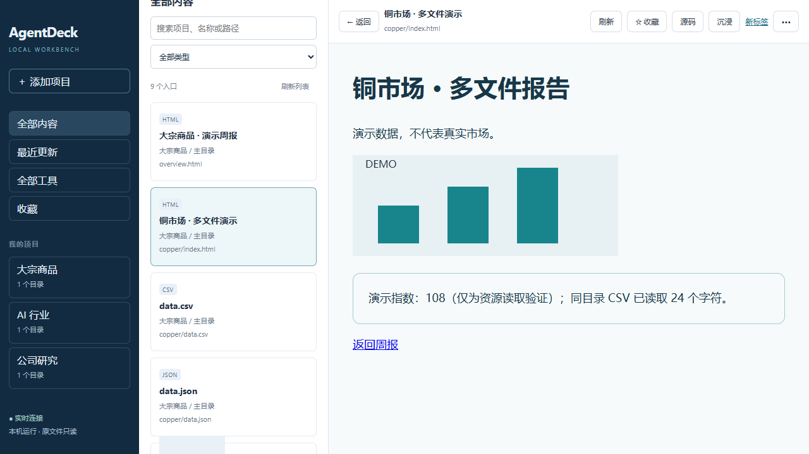

# AgentDeck — 本地内容阅读与静态工具工作台

AgentDeck 把 Agent 生成的 HTML 报告、Markdown 文档、图片、数据文件和纯前端小工具集中到一个浏览器工作台中。它挂载成果所在的真实目录，方便用户查找、阅读、对照和持续使用内容，不搬迁或改写源文件。

## 为什么做这个应用

Agent 交付的研究结果常常需要展示结论、图表、数据对比、来源和少量交互。HTML 比长篇纯文本更适合这类成果，而浏览器又是查看引用网页和原始资料最自然的环境。AgentDeck 让本地报告也在浏览器中阅读，减少在文件管理器、编辑器和网页之间反复切换。

它同时承载 Agent 生成的静态小工具，例如文本清理和单位换算。多标签、分屏、收藏、阅读位置恢复和更新提醒，让报告与工具可以反复使用。新增成果只需写入已挂载目录，不需要搬进统一仓库、逐份登记或修改平台源码。

完整的应用场景、产品原则和边界见 [产品定位](docs/PRODUCT.md)。



[竖屏界面](docs/screenshots/workbench-portrait.png) · [沉浸界面](docs/screenshots/workbench-immersive.png)

## 启动

需要 Node.js 22.12+。

```powershell
npm ci
npm run dev

# 正式模式
npm run build
npm start
```

打开 http://127.0.0.1:4310 。预览服务使用 4311 端口。两个服务都只监听回环地址，地址使用 `127.0.0.1`。

Windows 后台安装和更新：

```powershell
npm run background:install
npm run background:update
npm run background:status
```

安装方式、日志和故障处理见 [后台运行说明](docs/BACKGROUND.md)。默认状态目录为 `%LOCALAPPDATA%\AgentDeck\state`；其他系统为 `~/.local/share/AgentDeck/state`。也可以指定路径和端口：

```powershell
npm start -- --state-dir "D:\AgentDeck-State" --port 4310 --preview-port 4311
```

同一个状态目录只运行一个实例。

## 日常使用

- 临时查看单个文件时，点击顶部文件夹图标“打开本机文件”，或空白阅读区的同名按钮。可以浏览本机文件，也可粘贴绝对路径（支持 Windows“复制为路径”的引号）；无需添加项目或挂载目录。
- 文件直接在当前阅读区打开并保留标签，HTML 也在工作台内打开。同一文件在当前阅读区已打开时复用原标签，其他阅读区仍可用于对照；可以按需收藏，HTML 可以从“更多设置”加入工具，不自动归类。
- 未挂载文件的必要路径引用保存在本机状态中，刷新或重启后随阅读现场恢复；关闭标签不会立即删除引用。文件移动后，可从预览“更多设置”或不可用提示中重新选择，保留 ID、名称和收藏。位于现有挂载中的文件沿用挂载引用、停用状态与排除规则。
- 点击左侧“＋”添加项目并挂载真实目录。停用、卸载或移除项目只改变登记，不删除源文件。
- 文件树按需读取已展开目录，不预先递归扫描全部内容。筛选支持内置类型、自定义后缀和无后缀文件。
- 顶部“快速打开”可查已打开、收藏和工具中的文件，也可以按需搜索指定挂载目录中的文件名和路径。目录搜索最多显示 1000 个结果，不搜索正文。
- 当前文件的“更多”菜单可以复制完整路径；文件所在位置已挂载时，还能按需展开祖先目录并在文件树中定位。
- HTML、Markdown、图片、CSV、TXT、JSON 和常见代码可以直接查看；其他普通文件提供下载。隐藏敏感目录、密钥、依赖和明确排除的路径不会暴露，也不跟随 symlink 或 junction。
- “工具”支持独立登记本机 HTML。点击工具视图的“＋”，选择 `.html/.htm` 文件或粘贴绝对路径（支持 Windows“复制为路径”产生的引号），无需添加项目或挂载目录；名称自动填写，也可修改。文件选择器可浏览不同盘符，并记住上次位置。
- 工具原文件保持原地只读，重启后登记仍保留，停用或移除项目挂载不影响已经登记的工具。同一真实路径重复添加会打开已有工具，保留其名称；也可从 HTML 预览的“更多设置”中加入工具。
- 文件移动或目录离线时，工具保留在列表并显示“不可用”；用工具旁的文件夹按钮重新选择 HTML，名称、收藏和文件引用保留。重新选择会加载新文件，请先保存页面输入。移除工具只取消分类，不删除原文件，也不使已有收藏失效。

HTML 按原目录关系加载相邻资源。独立打开的 HTML 沿用独立工具的资源范围；独立 Markdown 允许范围内的图片和 HTML、Markdown、TXT、CSV、JSON 文档链接，其他独立文件只提供所选文件。独立打开不会把所在目录加入文件树、目录搜索或全局更新未读扫描；需要访问上级目录资源时，可以挂载相应的具体目录。Vite 工具应使用 `base: './'`，SPA 推荐使用 hash 路由。AgentDeck 不安装依赖、不执行构建脚本；需要构建的内容应先生成静态产物。

独立工具默认以 HTML 所在目录为资源范围，支持同目录及子目录资源，不自动访问 `../` 指向的上级目录。入口可放在用户主目录或盘符根目录；这两类宽泛位置只提供所选 HTML 与样式、脚本、图片、字体、JSON/CSV 等静态资源，避免发布其他文档。系统敏感目录、平台状态、隐藏敏感文件、UNC 与 symlink/junction 仍受限制。工具目录不会自动加入项目文件树或目录搜索。

Markdown 支持 GFM、相对图片和文档、标题目录与章节折叠，并过滤危险链接。图片可缩放；CSV 和 JSON 提供只读结构视图，超过安全展示限制时仍可查看原文或下载。

## 阅读与现场

每个阅读区都有独立标签、历史和页面状态。切换已加载的 HTML 不会重建页面，因此工具输入和页面内状态可以继续保留。固定标签可以避免它被后续打开的文件替换。

工作台支持上下或左右分屏、继续拆分、调整比例、单区最大化和沉浸阅读。页面布局、固定状态、文档滚动位置、侧栏和目录展开状态会保存在当前浏览器中。后台标签在首次激活时才读取内容，减少恢复大量页面时的开销。

“最近关闭”保存当前浏览器会话中的最近 20 条记录。“阅读现场”可以命名和固定，常用组合可另存复用。个人 JSON 备份包含通用阅读设置、收藏和常用组合，不包含源文件、挂载配置、工具输入或正在使用的 HTML 内存状态。

应用内“使用帮助”包含完整操作说明、快捷键和 Agent 任务模板：

[帮助页面](docs/screenshots/help-desktop.png) · [任务模板](docs/screenshots/help-prompts.png)

## 文件更新

“更新未读”会显示符合当前文件类型规则的新增和修改，包括尚未展开目录中的文件。首次建立基线不会把现有文件列成新增；连续变化会合并，同一状态目录下的页面共享未读状态。

工作台不会因为检测到变化就销毁当前页面。HTML 更新始终提示手动加载；文本可以按文件开启自动更新。HTML 还可以选择监测同目录静态资源变化。独立工具沿用已打开页面的版本检查与资源提示；没有挂载的工具目录不加入全局“更新未读”扫描。文件树、收藏和工具的可用性检查会在相应区域不可见时暂停。

## 与 Agent 协作

推荐流程：说明目标、资料、输出目录和验收标准 → Agent 把成果直接写入已有目录 → 在 AgentDeck 阅读或试用 → 用具体文件路径、现象和期望反馈 → 加载更新后的版本。

“使用帮助 → 任务模板”提供生成报告、制作工具、反馈修改和任务交接模板，并可带入真实挂载路径。适合 AgentDeck 阅读的内容结构、链接和静态工具约定见 [内容输出约定](docs/CONTENT-GUIDE.md)。

挂载目录只让 AgentDeck 读取文件，不会自动向其他 Agent 授予权限，也不会共享当前页面或对话上下文。

## 外观与操作

主题支持跟随系统、浅色和深色，并覆盖工作台及内置文档视图。HTML 页面保留自身设计，需要由页面自己提供夜间适配。

[浅色界面](docs/screenshots/theme-light.png) · [深色界面](docs/screenshots/theme-dark.png) · [窄屏深色界面](docs/screenshots/theme-mobile-dark.png)

设置中可以调整默认打开方式、阅读布局、现场、快捷键、外观和备份。常用快捷键包括：`O` 上下分屏、`E` 左右分屏、`X` 最大化、`P` 固定标签、`W` 关闭标签、`B` 收起侧栏、`F` 沉浸阅读、`/` 筛选、`?` 打开帮助。输入框、编辑区域和中文输入法组词时不会触发单键命令。

## 边界与安全

AgentDeck 面向本机单用户和可信目录。主界面与预览使用不同来源；管理接口校验 Host、Origin、Fetch Metadata、JSON 和请求头。每次读取、预览和下载都检查真实路径、挂载状态和排除规则。

所有项目共用同一个本机预览来源，不提供不互信项目之间的机密隔离。可信 HTML 可以按浏览器规则联网。根绝对资源路径、history 路由、SSR、后端 API、Service Worker、云部署和 UNC 不会自动适配。

服务端接口、安全边界和实现约束见 [后端说明](docs/BACKEND.md)。

## 开发与检查

```powershell
npm run typecheck
npm test
npm run build:example
npm run build
npm run test:e2e
```

浏览器测试默认在隔离状态和临时目录中使用本机 Edge；非 Windows 环境可设置 `PLAYWRIGHT_CHANNEL=chromium`。当前验证结果与覆盖范围见 [测试记录](docs/TEST-RESULTS.md)。

## 文档

- [产品定位](docs/PRODUCT.md)：长期应用场景、产品原则和边界。
- [内容输出约定](docs/CONTENT-GUIDE.md)：Agent 生成报告与静态工具时的约定。
- [后端说明](docs/BACKEND.md)：当前接口、安全和实现约束。
- [后台运行说明](docs/BACKGROUND.md)：Windows 后台安装、更新和故障处理。
- [测试记录](docs/TEST-RESULTS.md)：当前版本的验证摘要和限制。
- [问题日志](docs/ISSUES.md)：已确认问题及其处理记录。

历史方案和已完成实施批次通过 Git 提交记录追溯，不在当前工作区保留重复副本。
